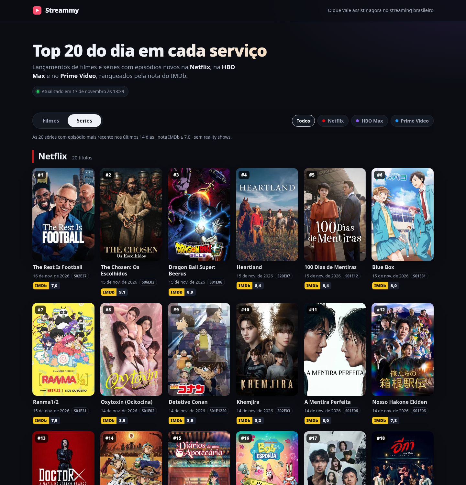
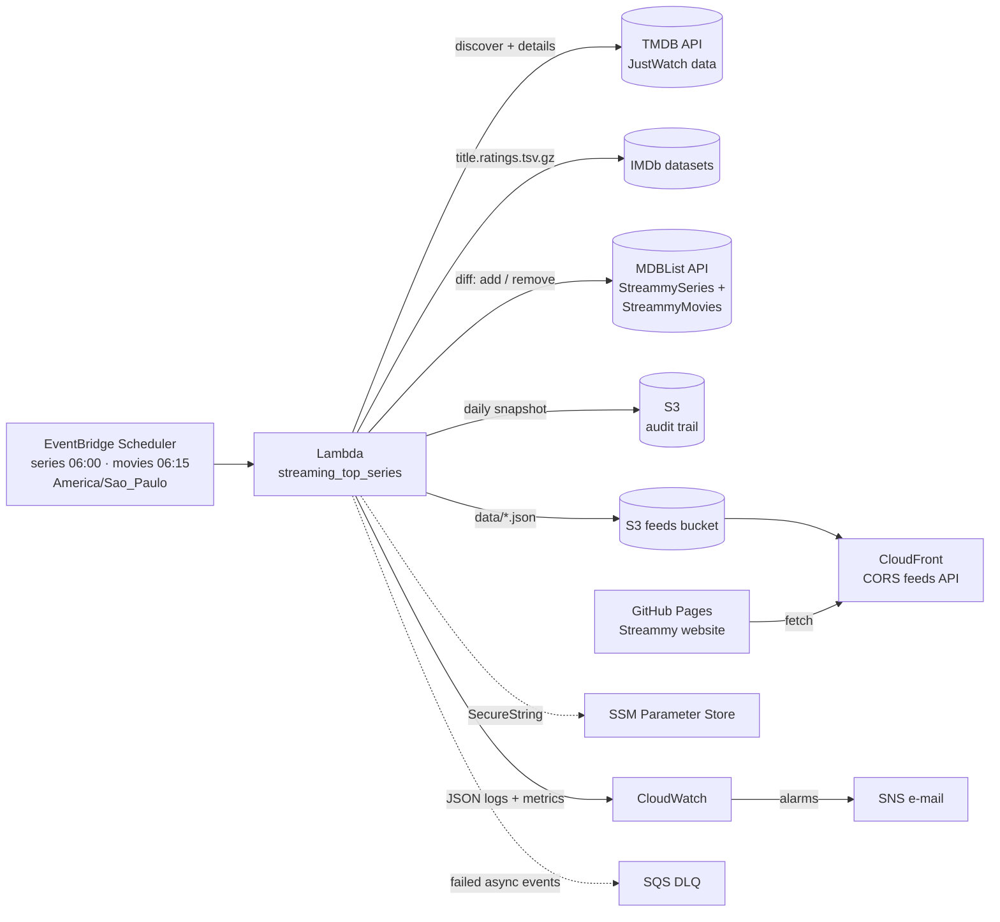

# Streaming Top Series BR

[](https://github.com/sauliiin/streaming-top-series-br/actions/workflows/ci.yml)


A serverless job that, every morning, curates public **MDBList** lists from what is new on
**Netflix**, **HBO Max** and **Prime Video** in Brazil. Scores come from **IMDb**, and TMDB is
used only as a fallback:

- **Series:** a single list, [**StreammySeries**](https://mdblist.com/lists/mestreyodarossi/streammyseries),
  with the 20 most recently aired, well-rated series of each service.
- **Movies:** a single list, [**StreammyMovies**](https://mdblist.com/lists/mestreyodarossi/streammymovies),
  with the latest 20 releases of each service.

The lists can be consumed by Stremio, Kodi, Plex and other MDBList integrations.

It also powers **[Streammy](https://sauliiin.github.io/streaming-top-series-br/)**, a fast static
website on GitHub Pages. It shows the same rankings, movies and series, separated by service, and
reads the daily JSON feeds the job publishes to AWS (S3 + CloudFront).



> 🇧🇷 [Leia em português](docs/README.pt-BR.md)

## How it works



For each provider the job:

1. queries TMDB for candidates in the service's flat-rate (subscription) catalog in Brazil;
2. fetches each candidate's details, including its IMDb id;
3. looks up the **IMDb rating** in the official dataset and falls back to the TMDB score only
   when IMDb has none (titles with no score at all are discarded);
4. applies the selection rules below, ranks the candidates and keeps the top 20;
5. computes the **diff** against the current MDBList list and applies only the changes;
6. stores the ranking and the diff as a JSON snapshot in S3.

### Selection rules

| Rule | Series (`StreammySeries`) | Movies (`StreammyMovies`) |
| --- | --- | --- |
| Recency | latest aired episodes; window starts at 14 days and widens 21 → 30 → 45 → … → 365 until 20 qualify (`WINDOW_STEPS_DAYS`) | latest releases; window widens 30 → 60 → 120 → 240 → 365 days until 20 qualify (`MOVIES_WINDOW_STEPS_DAYS`) |
| Release date | last aired episode | regional **digital** release, else premiere (streaming originals) |
| Minimum score (IMDb, TMDB fallback) | `6.0` (`MIN_VOTE`) | `5.0` (`MOVIES_MIN_SCORE`) |
| Excluded genres | Reality (`EXCLUDED_GENRES=10764`) | Comedy (`MOVIES_EXCLUDED_GENRES=35`) |
| Excluded franchises | Chicago, Law & Order / Lei & Ordem, NCIS (`EXCLUDED_TERMS`) | none |
| Ranking | latest episode date, then score | availability date, then score |
| Size | 20 per service in one list (`TOP_N`) | 20 per service in one list (`MOVIES_TOP_N`) |

## Engineering highlights

- **Hexagonal architecture**: pure domain rules (`domain/`), a use case that depends only on ports
  (`application/`), and swappable adapters (`infrastructure/`). Replacing TMDB or MDBList touches a
  single module. See [ADR 0001](docs/adr/0001-hexagonal-architecture.md).
- **Idempotent reconciliation**: the job converges the list to the desired state using a set diff;
  running it twice performs zero writes. See [ADR 0003](docs/adr/0003-idempotent-diff-sync.md).
- **Fail-safe by design**: if the upstream catalog degrades (fewer than `SAFETY_MIN_SELECTED`
  titles), removals are suppressed so a public list is never wiped by an outage. A failure in one
  provider is isolated from the others, and any provider failure blocks removals from the shared
  list so that provider's titles are not evicted.
- **IMDb-first scoring** using the official IMDb dataset: no API key, no rate limits. A
  streamed, filtered lookup keeps memory flat, and the file is cached for 20 h.
  See [ADR 0005](docs/adr/0005-imdb-ratings.md).
- **Zero runtime dependencies**: standard library only (plus `boto3`, bundled with Lambda). The
  deployment artefact is the source tree, with no layers and no supply-chain surface.
- **Security**: secrets live in SSM Parameter Store and never enter the Terraform state;
  least-privilege IAM; API keys are never logged or included in exceptions (covered by tests);
  CI/CD authenticates with **GitHub OIDC** and has no long-lived AWS keys.
- **Observability**: structured JSON logs (CloudWatch Logs Insights-ready), alarms for errors,
  a *dead man's switch* for missed runs, and a DLQ for exhausted retries.
- **Zero-build frontend**: semantic HTML, modern CSS (light and dark themes, responsive grid, snap
  scrolling on phones) and vanilla ES modules. All external text is rendered with `textContent`, and
  CloudFront enforces a strict CSP. When a provider fails, the feed keeps yesterday's section and
  marks it as stale instead of showing an empty row.
- **12-factor configuration** with a `--dry-run` mode, available both locally and per invocation.
- **Quality gates**: `ruff`, strict `mypy`, 81 unit tests (94% coverage), `terraform validate`,
  Dependabot.
- **Cost**: one invocation a day sits comfortably within the AWS free tier.

## Repository layout

```
.
├── src/streaming_top_series/
│   ├── domain/            # entities, ratings, selection rules, diff (pure, no I/O)
│   ├── application/       # ports + series and movie sync use cases
│   ├── infrastructure/    # TMDB, IMDb, MDBList, S3, SSM and HTTP adapters
│   ├── entrypoints/       # AWS Lambda handler and CLI
│   ├── bootstrap.py       # composition root
│   └── settings.py        # 12-factor settings
├── tests/                 # unit tests mirroring the package layout
├── web/                   # static website (feeds land in web/data/ locally, data/ in S3)
├── infra/
│   ├── bootstrap/         # one-time: state bucket, GitHub OIDC, deploy role
│   └── terraform/         # application stack
├── docs/                  # architecture, runbook, ADRs
└── .github/workflows/     # CI and deploy pipelines
```

## Getting started

Requirements: Python 3.12+, a [TMDB API key](https://www.themoviedb.org/settings/api) and an
[MDBList API key](https://mdblist.com/preferences/).

```bash
python -m venv .venv && source .venv/bin/activate
make install                       # editable install with dev tools
cp .env.example .env               # fill in your keys, then: set -a; source .env; set +a
make check                         # lint + type-check + tests
make run-dry-run                   # today's rankings and diffs, no writes
make site-preview                  # build today's feeds and open the site at http://127.0.0.1:8765
streaming-top-series --job movies  # real sync of StreammyMovies (series | movies | all)
```

`make test` runs the suite with the standard-library runner, without installing anything.

## Deployment

The full procedure is in the [runbook](docs/runbook.md). In short:

1. `infra/bootstrap`: apply once with admin credentials to create the state bucket, the OIDC
   provider and the deploy role.
2. Create the two SecureString parameters in SSM: `tmdb_api_key` and `mdblist_api_key`.
3. Set the GitHub repository variables `AWS_REGION`, `AWS_DEPLOY_ROLE_ARN` and `TF_STATE_BUCKET`
   (both workflows are skipped until they exist).
4. Push to `main`. The **Deploy** workflow plans, applies and runs a dry-run smoke test.
5. Set `FEEDS_BASE_URL` (Terraform output `feeds_base_url`) and enable GitHub Pages with the
   "GitHub Actions" source. The **Pages** workflow injects the feeds URL and publishes `web/`.

## Documentation

- [Architecture](docs/architecture.md)
- [Runbook](docs/runbook.md): deployment, operations and troubleshooting
- [Architecture Decision Records](docs/adr/)

## Data attribution

This product uses the TMDB API but is not endorsed or certified by TMDB. Streaming availability
data is provided by [JustWatch](https://www.justwatch.com/) through TMDB. Ratings courtesy of
[IMDb](https://www.imdb.com/) ([datasets](https://developer.imdb.com/non-commercial-datasets/),
used under their personal and non-commercial terms).

## License

[MIT](LICENSE)
