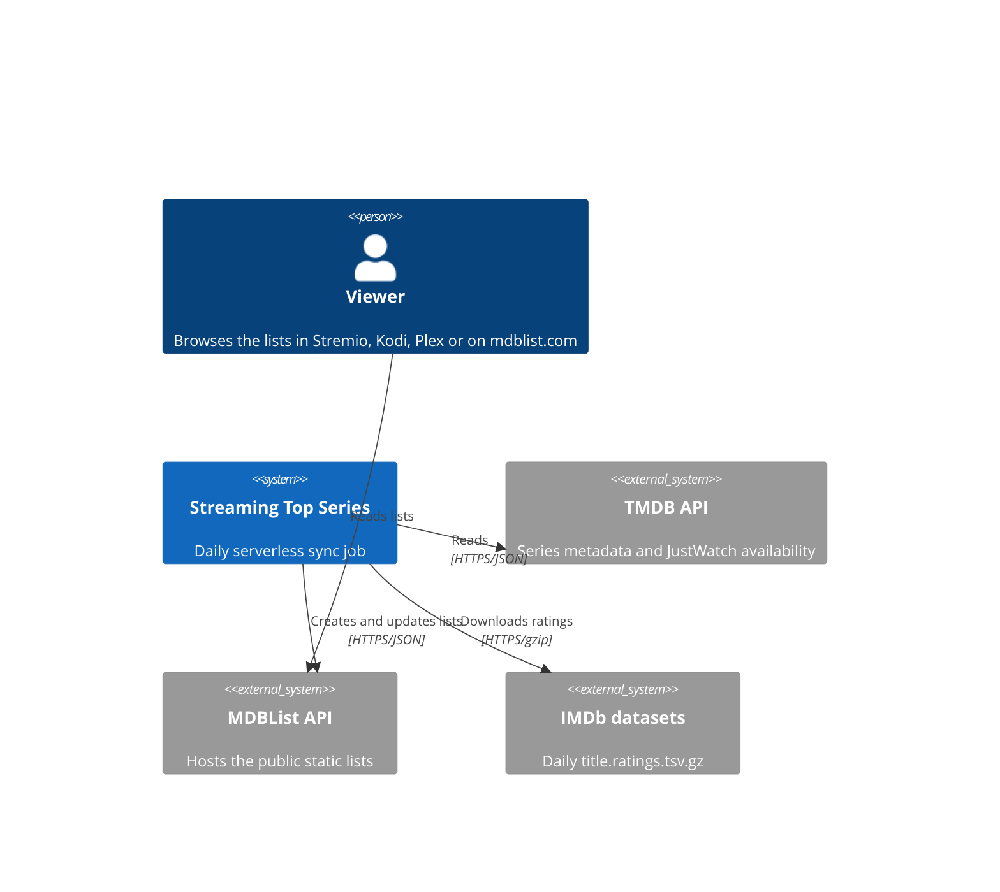

# Architecture

## Context



## Layers

| Layer | Package | Depends on | Responsibility |
| --- | --- | --- | --- |
| Domain | `domain/` | nothing | Entities (`Show`, `Movie`, `Episode`, `Provider`, `Rating`), criteria, IMDb-first scoring, selection and diff rules |
| Application | `application/` | domain | Ports (`ShowCatalog`, `MovieCatalog`, `RatingsProvider`, `ListRepository`, `SnapshotStore`) and the `TopSeriesSyncService` / `MovieListSyncService` use cases |
| Infrastructure | `infrastructure/` | application, domain | TMDB, IMDb dataset, MDBList, S3 and SSM adapters, plus a retrying HTTP client |
| Entrypoints | `entrypoints/` | bootstrap | Lambda handler and CLI |
| Composition root | `bootstrap.py` | all | Wires concrete adapters from `Settings` |

Dependencies point inwards only. The domain can be tested exhaustively with plain data, and the use
case is tested with in-memory fakes of its ports. Adapters are tested against a fake HTTP transport.

## Sync algorithm

```
for provider in providers:                       # failures are isolated per provider
    candidates = catalog.recent_shows(provider)  # TMDB discover + details
    selection  = select_top(candidates)          # filter -> rank -> top N (deterministic)
    list       = lists.ensure_list(name)         # find the static list or create it (public)
    diff       = desired - current, current - desired
    if len(selection) < SAFETY_MIN_SELECTED:     # upstream degraded -> never remove
        diff.to_remove = {}
    apply(diff) unless dry_run or diff is empty
snapshot(report)                                 # best effort; never fails the run
raise if any provider failed                     # drives the CloudWatch Errors alarm
```

Both jobs share this skeleton (`ConsolidatedListSync`). Each provider's Top 20 is merged into one
list per job, `StreammySeries` or `StreammyMovies`. Each provider widens its window step by step
until 20 titles qualify: 14 → 365 days for series, 30 → 365 days for movies. Removals are allowed
only when every provider answered with a healthy amount of titles.

## Runtime topology (AWS)

| Concern | Service | Notes |
| --- | --- | --- |
| Trigger | EventBridge Scheduler, one schedule per job | series 06:00, movies 06:15 (`America/Sao_Paulo`), 2 delivery retries |
| Compute | Lambda (Python 3.13, arm64, 512 MB, 10 min timeout) | async invoke config: 1 retry, then SQS DLQ; IMDb dataset cached in `/tmp` |
| Secrets | SSM Parameter Store (SecureString) | read at cold start, cached per container |
| Audit trail | S3 (`snapshots/{series,movies}/YYYY-MM-DD.json`) | SSE-S3, TLS-only policy, public access blocked, 365-day expiry |
| Website | GitHub Pages (static `web/`, CSP via meta tag) | deployed by the Pages workflow on changes to `web/` |
| Data feeds | S3 (private) + CloudFront (OAC, HTTP/3, CORS for the Pages origin only) | `data/*.json` refreshed by the job daily (5-min cache), fetched by the site at runtime |
| Logs | CloudWatch Logs | JSON lines, 30-day retention |
| Alerting | CloudWatch alarms → SNS | errors, missed run (24 h), DLQ depth |
| Delivery | GitHub Actions + OIDC → Terraform (S3 backend, native lock file) | dry-run smoke test after apply |

## Well-Architected mapping

| Pillar | Decisions |
| --- | --- |
| Operational excellence | IaC for everything, CI quality gates, runbook, structured logs, dry-run mode |
| Security | OIDC instead of access keys, least-privilege roles, secrets outside state and code, keys redacted from errors |
| Reliability | Retries with exponential backoff, failure isolation, fail-safe removals, DLQ, missed-run alarm |
| Performance efficiency | Bounded parallel detail fetches, early exclusion before detail calls, arm64 |
| Cost optimisation | Fully serverless, one invocation a day, no runtime dependencies or layers |
| Sustainability | Graviton (arm64), short-lived compute, log and snapshot retention limits |
